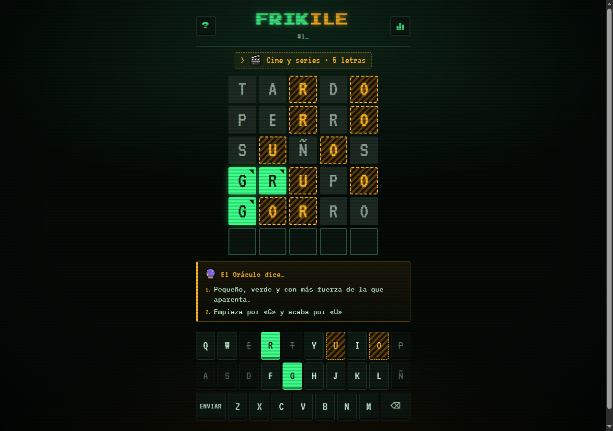
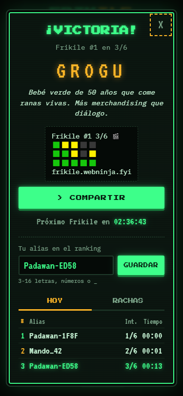

# Frikile

[](https://github.com/Ogires/frikile/actions/workflows/ci.yml)

El Wordle de las palabras frikis: una palabra al día, igual para todo el mundo, sacada de Star Wars, Zelda, Doctor Who, Dragon Ball o el día a día de cualquier dev. Seis intentos, pistas de un Oráculo con IA y ranking de rachas. Coste de producción: 0 €.

**▶ Juega en <https://frikile.webninja.fyi>**

<p align="center">
  
  
</p>

## Cómo se juega

- Cada día hay una palabra friki de **5 a 8 letras**, y desde el principio sabes su categoría (🎮 videojuegos, 🎬 cine y series, 🚀 ciencia ficción, 📚 fantasía, 💻 dev, 🐉 anime y manga).
- Tienes 6 intentos. 🟩 letra en su sitio · 🟨 está pero en otro sitio · ⬛ no está. Las casillas llevan además patrón y borde, así que se distinguen sin depender del color.
- Al tercer fallo, **el Oráculo Friki** te da una pista críptica; al quinto, una más clara.
- Al terminar ves la definición (sarcástica) de la palabra, compartes tu grid de emojis y entras en el ranking del día y en el de rachas.

## Arquitectura

```
┌──────────────────── Navegador ──────────────────┐
│ index.html + app.js + styles.css (vanilla)      │
│ · tablero N×6 + teclado ES con Ñ                │
│ · UUID anónimo + alias en localStorage          │
└───────┬──────────────────────────────▲──────────┘
        │ fetch JSON /api/*            │
┌───────▼──────────────────────────────┴──────────┐
│ Cloudflare Worker (assets + API, un deploy)     │
│ · palabra del día determinista (Europe/Madrid)  │
│ · evaluación de colores en servidor             │
│ · partidas con bloqueo optimista                │
│ · rachas sin cron · ranking del día             │
│ · rate limit 30 intentos/min/IP                 │
└──┬──────────────┬─────────────────┬─────────────┘
   │ D1 (SQLite)  │ KV              │ Groq (LLM)
   palabras       pistas del día    1 llamada al día
   jugadores      rate limit
   partidas
```

Decisiones de diseño:

- **El servidor manda.** El navegador nunca conoce la palabra: cada intento va a `POST /api/intento` y el Worker devuelve solo los colores. La palabra viaja al cliente cuando la partida ha terminado. El tiempo del ranking también se mide en el servidor.
- **Palabra del día sin cron.** `orden = días desde el lanzamiento % tamaño del catálogo`. Se calcula al vuelo con la fecha de Madrid (con tests de los cambios de hora de marzo y octubre).
- **Rachas sin jobs nocturnos.** Si faltas un día no se escribe nada: la racha "muere" al leerla (`ultima_fecha_ganada` tiene que ser hoy o ayer).
- **Bloqueo optimista.** Cada `UPDATE` exige el número de intentos leído; un doble clic o dos pestañas nunca cuentan un intento dos veces.
- **IA fuera del camino crítico.** Groq (`openai/gpt-oss-120b`) solo escribe las pistas. Como la palabra es la misma para todos, se generan **una vez al día** y se cachean en KV: sirva a 10 jugadores o a 10.000, es una llamada. El Worker comprueba que la pista no contiene la palabra ni su raíz; si la contiene o Groq falla, usa una pista escrita a mano. El juego nunca depende de la IA.
- **Un único Worker** con `assets` sirve frontend y API. Frontend vanilla sin build.

## Anti-trampas (y lo que se asume)

| Truco | ¿Funciona? |
|---|---|
| Leer la palabra en el JS, la red o el repo | No: solo está en D1 y el catálogo no es público (ver abajo) |
| Inventarse un tiempo de 3 segundos | No: el cronómetro es del servidor |
| Pedir las pistas antes de tiempo | No: solo llegan en la respuesta cuando están desbloqueadas |
| Fuerza bruta de intentos | Limitado a 30/min por IP |
| Jugar con un UUID desechable para descubrir la palabra y luego "ganar" con el bueno | Sí. Cerrarlo exigiría login, y no compensa en un juego así. Asumido |

## Catálogo privado

El repo es público, así que el catálogo real (`data/palabras.json`, ~150 palabras curadas) **no está versionado**: con él y la fórmula del día cualquiera sabría la palabra de mañana. En el repo hay `data/palabras.ejemplo.json` (20 entradas) para los tests y para quien lo clone.

- `npm run seed -- --local|--remote` carga el catálogo en D1 de forma **incremental**: las palabras existentes conservan su `orden` (no cambia lo ya jugado) y las nuevas se barajan y se añaden al final.
- `npm run catalogo -- 30 "🎮 Videojuegos"` pide a Groq propuestas de nuevas entradas, las valida y las deja en `data/propuestas-*.json` para **revisión humana**. La IA propone; un humano decide qué entra.

## API

| Método | Ruta | Qué hace |
|---|---|---|
| `GET` | `/api/hoy?jugador=<uuid>` | Número del día, longitud, categoría, alias y tu partida si la hay |
| `POST` | `/api/intento` | `{ jugador, intento }` → colores, estado, pistas desbloqueadas (y palabra + definición al terminar) |
| `POST` | `/api/alias` | `{ jugador, alias }` (3-16 letras, números o `_`) |
| `GET` | `/api/ranking?tipo=hoy\|rachas` | Top 20 del día (intentos, tiempo) o de rachas vivas |

Errores con gracia: `400` intento inválido ("Eso no existe ni en klingon"), `409` partida terminada o conflicto, `429` "Los Nazgûl vigilan esta IP", `503` "El Oráculo está en mantenimiento".

## Desarrollo local

```bash
npm install
npx wrangler d1 migrations apply frikile --local
npm run seed -- --local data/palabras.ejemplo.json
# opcional, para pistas con IA: crea .dev.vars con GROQ_API_KEY=... (console.groq.com/keys)
npm run dev        # http://localhost:8787
npm test           # 75 tests sobre el runtime real de Workers (D1 y KV incluidos)
npm run typecheck
```

## Despliegue

```bash
npx wrangler d1 create frikile && npx wrangler kv namespace create frikile   # ids → wrangler.jsonc
npx wrangler d1 migrations apply frikile --remote
npm run seed -- --remote
npx wrangler secret put GROQ_API_KEY
npm run deploy     # https://frikile.webninja.fyi
```

Cada push a `main` pasa typecheck + tests en GitHub Actions y despliega el Worker. Migraciones y catálogo se aplican a mano (el catálogo no sale del equipo local).

Diseño completo en [`docs/plans/`](docs/plans/).

## Hecho con

TypeScript · Cloudflare Workers, D1 y KV · Groq · Vitest con `@cloudflare/vitest-plugin` · GitHub Actions. Y demasiadas horas de Final Fantasy.

## Licencia

[MIT](LICENSE)
